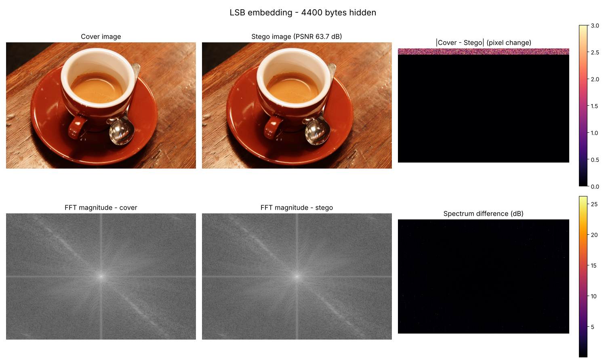
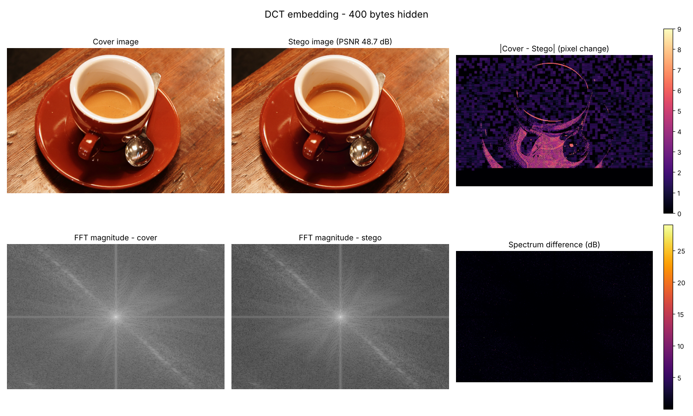

<h1 align="center">Image Steganography with FFT Analysis</h1>

<p align="center">
  Hide secret text inside images, then show in the frequency domain that the hiding can't be seen. Includes a Python desktop app, a command-line tool and a tested core library.
</p>

<p align="center">
  
  
  
  <a href="https://github.com/SujithPG-coder/image-steganography-fft/actions/workflows/tests.yml"></a>
  
</p>

<p align="center">
  
</p>

---

## Overview

**Steganography** hides the fact that a message exists at all, by embedding it inside an ordinary-looking cover image. This project covers the full workflow:

1. **Pre-processing:** load an image and convert the message to a binary stream.
2. **Embedding:** hide the bits in the spatial domain (LSB) or the frequency domain (block DCT).
3. **FFT / IFFT analysis:** compare the 2-D magnitude spectra of the cover and stego images and rebuild the image from its spectrum.
4. **Extraction:** recover the exact original message from the stego image.
5. **Quality check:** measure distortion with MSE and PSNR.

## Features

- **Two embedding methods**

  | Method | Domain | Capacity (600×400 image) | Typical PSNR | Idea |
  |---|---|---|---|---|
  | `lsb` | Spatial | ~80,000 bytes | > 60 dB | 8 data bits + 1 stop flag in the LSBs of 3 pixels per byte |
  | `dct` | Frequency | ~460 bytes | ~ 48 dB | 1 bit per 8×8 block, using Quantisation Index Modulation (QIM) on a mid-frequency DCT coefficient |

- **Desktop GUI** (Tkinter): choose an image, type a message, save the stego image, and view FFT spectra before and after encoding
- **Command-line tool** for scripted encode, decode and analysis
- **Full UTF-8 support** (any language, emoji)
- **Safety checks:** warns when a message is too large and always saves lossless PNG, because JPEG compression would destroy the hidden bits
- **Unit tests:** round-trip, extreme pixel values (0 and 255), RGBA and grayscale inputs, capacity limits and imperceptibility

## Results

The difference maps show that pixel changes are tiny. The **FFT magnitude spectra of the cover and stego images look the same**, so the hidden data can't be seen in either the spatial or the frequency domain.

| LSB (spatial domain), 4,400 bytes hidden, PSNR 63.7 dB |
|:---:|
|  |
| **DCT-QIM (frequency domain), 400 bytes hidden, PSNR 48.7 dB** |
|  |

## Getting Started

```bash
git clone https://github.com/SujithPG-coder/image-steganography-fft.git
cd image-steganography-fft
pip install -r requirements.txt
```

### Desktop application

```bash
python app.py
```

**Encode Image** → choose a cover image → pick a method → type the message → **Encode & Save**
**Decode Image** → choose the stego image → **Decode**

### Command line

```bash
# Hide a message
python cli.py encode -i examples/cover.png -o secret.png -m "Meet at 5 PM"

# Hide a text file in the frequency domain
python cli.py encode -i examples/cover.png -o secret.png -f message.txt --method dct

# Recover the message
python cli.py decode -i secret.png
python cli.py decode -i secret.png --method dct

# FFT comparison figure
python cli.py analyze -c examples/cover.png -s secret.png -o analysis.png
```

### As a library

```python
from PIL import Image
from stego.core import encode, decode, psnr

cover = Image.open("examples/cover.png")
stego = encode(cover, "Hello, World!", method="lsb")
stego.save("stego.png")                   # always save as PNG
print(decode(Image.open("stego.png")))    # -> Hello, World!
print(f"PSNR: {psnr(cover, stego):.2f} dB")
```

### Run the tests

```bash
pip install -r requirements-dev.txt
pytest -q
```

## How It Works

**LSB embedding.** Each message byte uses 9 colour values (3 RGB pixels). The first 8 values store the data bits in their least-significant bit. The 9th value marks the end: even means more data follows, odd means this is the last byte. Each pixel value changes by at most ±1, which the eye can't see.

**DCT-QIM embedding.** The blue channel is split into 8×8 blocks and each block is transformed with the 2-D DCT. Coefficient (3,4) is snapped to the nearest point of one of two interleaved grids (step Δ = 30): the *even* grid for bit 0, the *odd* grid for bit 1. The decoder reads which grid the coefficient sits on. A 32-bit length header comes first. Because Δ/2 is far larger than the rounding error, the data survives conversion back to 8-bit pixels.

**FFT analysis.** `np.fft.fft2` + `fftshift` give the centred log-magnitude spectrum. Comparing cover and stego spectra shows how much each method changes the frequency content. `ifft2` rebuilds the image to confirm the transform is lossless.

## Repository Structure

```
image-steganography-fft/
├── app.py                 # Tkinter desktop application
├── cli.py                 # Command-line interface
├── stego/
│   └── core.py            # LSB + DCT embedding, FFT analysis, PSNR
├── tests/
│   └── test_core.py       # pytest unit tests
├── examples/
│   ├── make_figures.py    # Generates the README figures
│   ├── cover.png          # Sample cover image (CC0, scikit-image)
│   ├── stego_lsb.png
│   └── stego_dct.png
├── docs/
│   └── images/
├── requirements.txt
└── requirements-dev.txt
```

## Tech Stack

**Language:** Python · **Libraries:** NumPy, SciPy, Pillow, Matplotlib, Tkinter · **Concepts:** 2-D FFT/IFFT, DCT, quantisation index modulation, LSB steganography, PSNR

## Author

**Sujith Krishna P G**

<a href="https://github.com/SujithPG-coder"></a>
<a href="https://www.linkedin.com/in/sujithkrishnapg/"></a>

## License

This project is licensed under the [MIT License](LICENSE).
